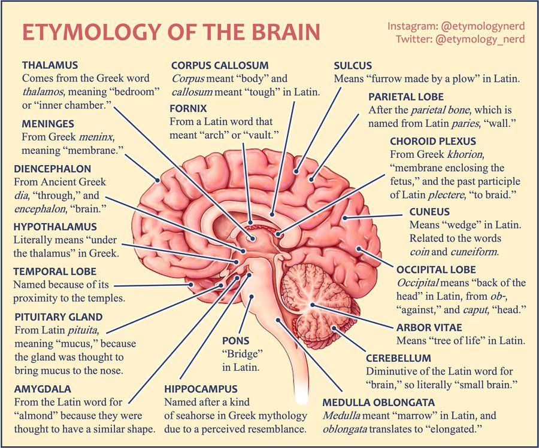
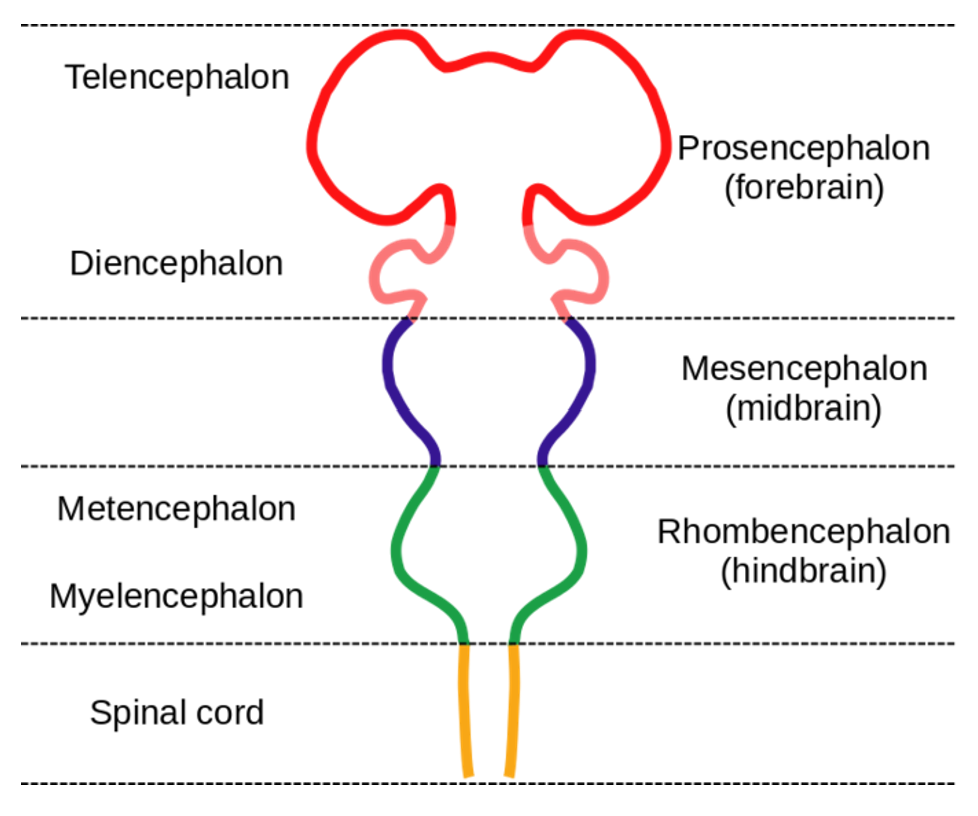
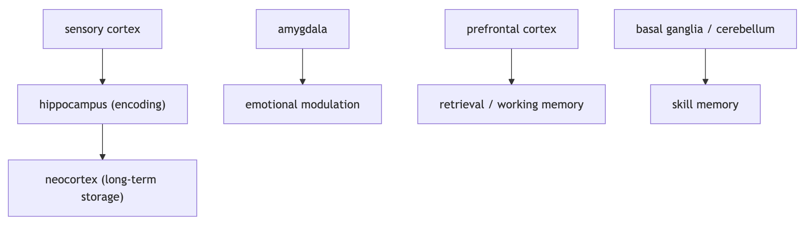

Welcome to the first lesson studying the most powerful and intelligent computer known to date - the brain. We will begin by studying what the brain is exactly. This is called neuroanatomy/brain anatomy. The reason why we start with neuroanatomy is that deep learning does not attempt to model the “mind” itself (yet). However, it is loosely inspired by how the brain structurally processes the information.

---

## Literacy & Technical Track Content

### Task 1

*Read the article below, and answer the following synthesis questions.*

#### Introduction

The human brain is composed of multiple layers, and understanding each part is crucial for learning how brain cognition works. Besides just the chemical communication from neurons we learned from the lecture, the brain organizes information throughout its distinctive structures, each with specific roles and pathways.

First, let’s look at the structure of neuroanatomy. You may have seen an image like this before ([source](https://socialsci.libretexts.org/Bookshelves/Early_Childhood_Education/Child_Development_%28Cummings-Clay%29/01%3A_Introduction_to_Child_Development/1.02%3A_Development_of_the_Human_Brain)):

The brain has three major regions: Forebrain, Midbrain, and Hindbrain, and the “-encephalon” term reflects an embryological subdivision of the brain. During early embryonic development, the brain primarily appears as three vesicles (prosencephalon, mesencephalon, and rhombencephalon) and spinal cord, which then differentiate into more specialized subregions as development proceeds. Since embryological subdivision is the root of all brain structure, developmental origin constrains anatomical boundaries, connectivity, and function in the adult human brain.

Now, let's talk about each region and its subdivisions.

#### The Forebrain

The Forebrain has two subdivisions: the **Telencephalon** and **Diencephalon**.

The **Telencephalon** contains the Cerebral cortex, Basal ganglia, and Limbic system, and it supports perception, motivation, and even memory.

The **Cerebral cortex** is a layer of gray matter divided into four Lobes and the **Insula** (visceral sensation).

The four Lobes function differently in learning and cognitive processes:

* Frontal lobe: executive function, decision-making, motor planning
* Parietal lobe: somatosensory processing and spatial integration
* Occipital lobe: visual processing
* Temporal lobe: auditory processing, language, and memory

The **Insula** is a cortical region involved in visceral sensation, interoception, and awareness of internal bodily states.

There is a structure called the **corpus callosum,** a major white-matter tract within the **telencephalon**, that connects the left and right cerebral hemispheres and enables information exchange across cortical regions. This lets cerebral hemispheres communicate with each other and integrate perception, action, and cognition into a coherent experience.

**Basal ganglia** includes the Caudate nucleus, Putamen, and Globus pallidus:

* Caudate nucleus: processes goal-directed learning, working memory.
* Putamen: related to motor skills, planning and preparation
* Globus pallidus: regulates voluntary movement

**Limbic system** includes the Amygdala and Hippocampus:

* Amygdala: rapid evaluation of sensory information, emotional responses to external stimuli
* Hippocampus: spatial navigation and episodic memory

The **Diencephalon** contains the **Thalamus** and **Hypothalamus**, which control attention and physiological state by regulating signals.

**Thalamus** routes sensory information to the appropriate cortical areas and modulates attention. Rather than simply relaying information, the **Thalamus** filters and prioritizes signals based on relevance and feedback.

**Hypothalamus** regulates the body’s internal physiological state, such as temperature, hunger, and thirst, and processes motivation, arousal, and autonomic nervous system control. It makes sure that our cognition is context-dependent and bodily grounded.

#### Synthesis Questions

- You are walking in the forest at night and you suddenly see something that looks like a snake. Your heart rate increases, you start feeling fear, and then later realize it was just a stick. Using the forebrain structures, explain how this entire process unfolds in the role of each part of the forebrain.
- Explain why Cerebral Cortex, Basal Ganglia, and the Limbic System cannot be understood independently.

#### The Midbrain

The **Midbrain** is divided into **Tectum** and **Tegmentum**; where the **Tectum** is dorsal which contains **Superior colliculus** and **Inferior colliculus**, and the **Tegmentum** is ventral and contains **Substantia nigra**, **VTA (ventral tegmental area)** and **Periaqueductal gray**.

**Tectum**

* **Superior colliculus** processes visual stimuli and coordinates rapid movements of the eyes and head. This area supports physical implementation of spatial attention for motor responses.
* **Inferior colliculus** processes auditory information for sound localization. This area supports reflexive responses to auditory stimuli.

**Tegmentum**

* The **Tegmentum** contains the **Substantia nigra**, which is a dopaminergic nucleus that is functionally connected to the basal ganglia and plays a critical role in movement and reward-based learning (this is what we call reinforcement learning\!).
* The **Tegmentum** contains the **VTA, a.k.a. ventral tegmental area,** which is another dopaminergic nucleus within the tegmentum. It is involved in motivation and reward processing, learning, assigning value to stimuli and actions (also connected with reinforcement learning).
* The **Tegmentum** contains the **Periaqueductal gray,** which surrounds the cerebral aqueduct and is involved in defensive, autonomic responses to threat.

#### Synthesis Questions

- How does the Mesencephalon integrate sensory information, motor responses and reward processes into coordinated behavior systems?
- What does it mean that the Midbrain combines a reflex system and a learning system? Explain this integration in terms of neural function.
- What is the role of neural communication in the Midbrain in linking sensory processing, motor responses, and reward-based learning?

#### The Hindbrain

The Hindbrain has two subdivisions: the **Metencephalon** and **Myelencephalon**.

The **Metencephalon** contains the **Pons** and **Cerebellum**.

* The **Pons** controls sleep and wakefulness and relays signals between the cerebellum and cerebrum.
* The **Cerebellum** is named for its appearance: *cerebellum* is Latin for “little brain,” and it looks like a small brain tucked under the cerebrum. It coordinates movement and balance, and supports associative learning.

The **Myelencephalon** contains the **Medulla**.

* The **Medulla** controls vital autonomic functions like the respiratory system, heart rate, and blood pressure.

#### Synthesis Questions

- Explain how the Pons, Cerebellum, and Medulla work together to keep stable bodily function.
- Why is the cerebellum referred to as the “little brain”? Explain in terms of its structure, functions, and role in neural communication.

Congratulations! That was a lot of neuroscience! On to some more creative ways of learning in the project section. Using this interactive 3D model from BrainFacts, we can understand the brain is not a set of isolated parts but is highly interconnected. This visualization reinforces a key concept of neuroscience, brain function emerges from connectivity, not just individual regions!

[BrainFacts 3D Interactive Model](https://www.brainfacts.org/3d-brain#intro=false&focus=Brain-corpus_callosum)

#### Synthesis Questions

- Based on the 3D brain model, how do different brain regions appear to be spatially organized to support communication and integration rather than isolated processing?
- Where is the Hippocampus located in the 3D model, and how might its location support its role in memory and spatial navigation?

Now, let’s move on to memory and how memory works within brain anatomy.

#### Types of Memory in Human Cognition

Memory is not just regulated by a certain part of the brain. It is a network, just like this:

The **hippocampus** in the medial temporal lobe is critical for forming new episodic memories and converting short-term memories into long-term storage. The **amygdala** strengthens memories that are emotionally significant, such as fear or stressful events. The **prefrontal cortex** supports **working memory** and helps retrieve and organize stored information during thinking and decision-making. In contrast, **procedural memories** (skills and habits) rely more on the **basal ganglia** and **cerebellum**, which support motor learning and automatic behaviors.

#### Synthesis Questions

- Why might a traumatic event be remembered more vividly than a routine daily occurrence?
- Name two types of memories and identify which brain structure supports each one.
- According to the passage, why is memory described as a "network" rather than being controlled by a single brain structure?

### Task 2

*Complete the following writing activity.*

**There is no programming for this project. Instead, we have provided a $\LaTeX$ template for you to fill out.**

* If you are unaware of what $\LaTeX$ is, you can read [the LaTeX project's introduction](https://www.latex-project.org/about/).

I would recommend taking a look at [Overleaf](https://www.overleaf.com/project) to edit/compile $\LaTeX$ code. Simply copy the code in the template into a blank
Overleaf project and type your answers into the `TODO` areas. Be sure to hit the "Recompile" button to see your work.

Since this is the "project" section of the unit, your responses to the questions we provide should be more complex than
your responses to the synthesis questions.

**GH Link:** [Unit 2 Template](https://github.com/interactive-intelligence/intro-neuro-ai-website/blob/main/notebooks/unit-02/basic_neuro_project.tex) **(30 min)**

**The questions in the template are also written below:**

Unfortunately, we have neither brains nor creatures for you to dissect. However, for this project, we will be asking you to use your imagination and newfound knowledge of biology and artificial intelligence to:

* Describe several advantages and disadvantages of biological computation with the brain compared to machine learning
* Speculate what aspects of the architecture of the brain may cause these advantages or disadvantages, and similarly comment on aspects of machine learning’s architecture
* Brainstorm some marvelous schemes for integrating advantages from both ways of computing. Draw, write, scribble etc… When you are done, do a quick google for your best ideas to see if anyone has researched or tried them already!

Whatever you are able to conjure up, have something to show for it to demonstrate your knowledge about basic neuroanatomy!
