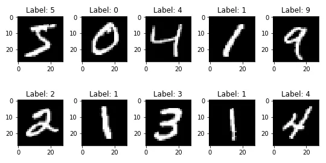
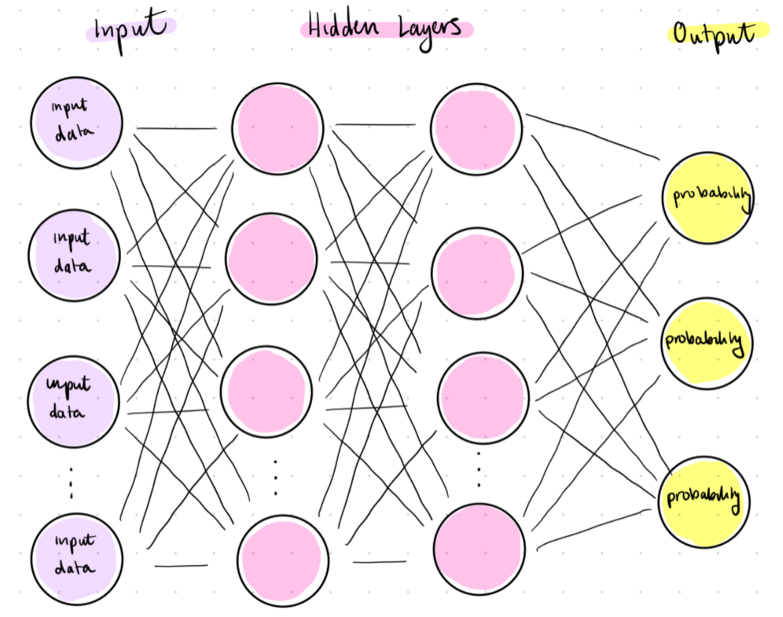
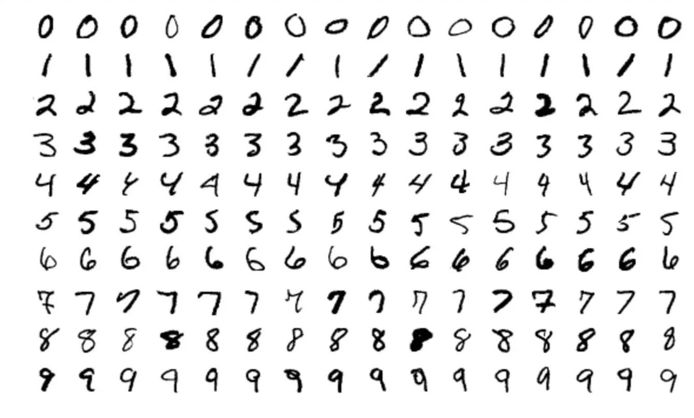
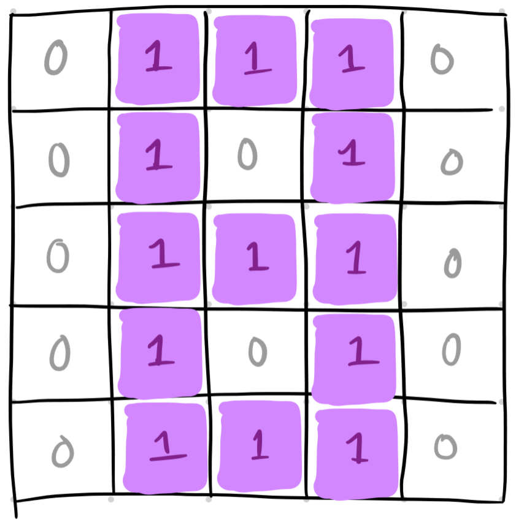
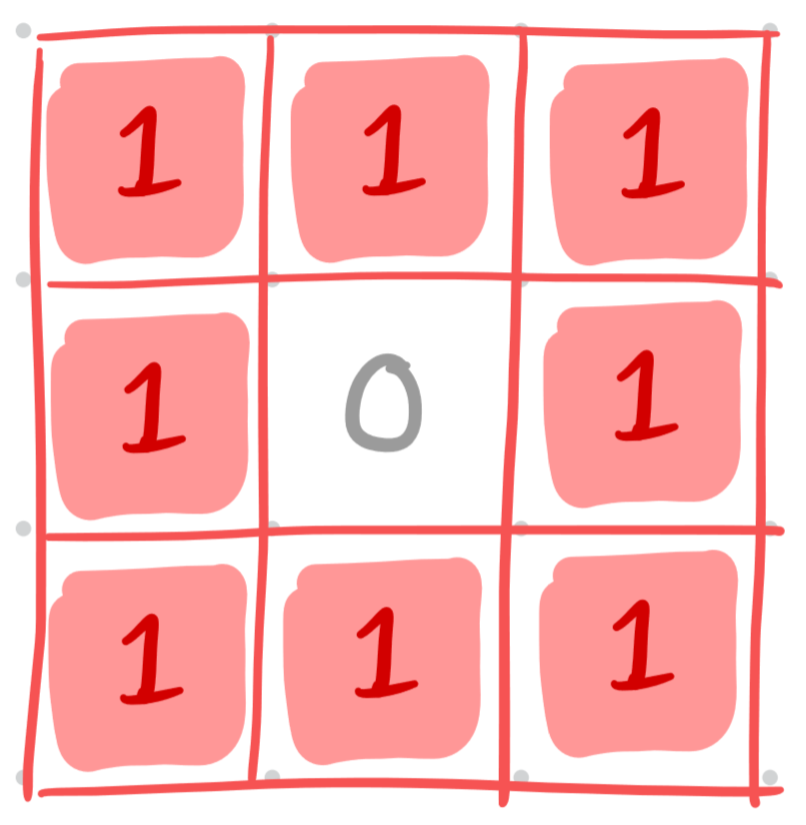
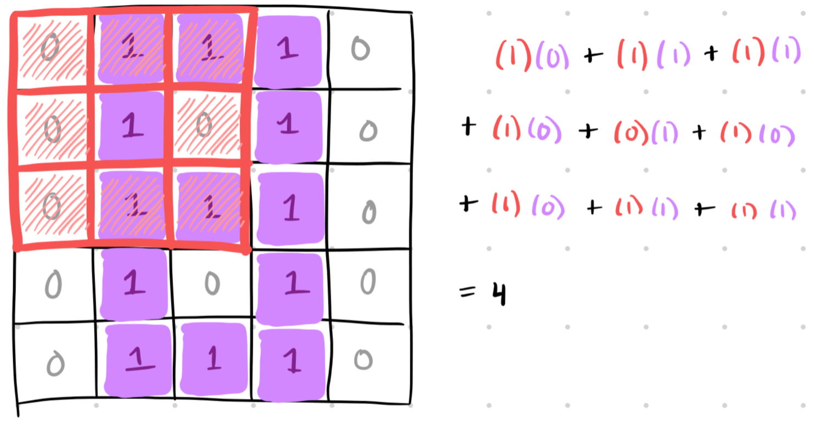
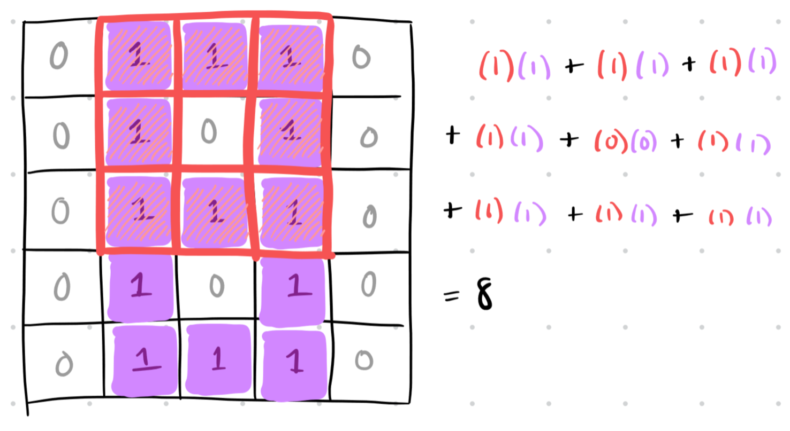
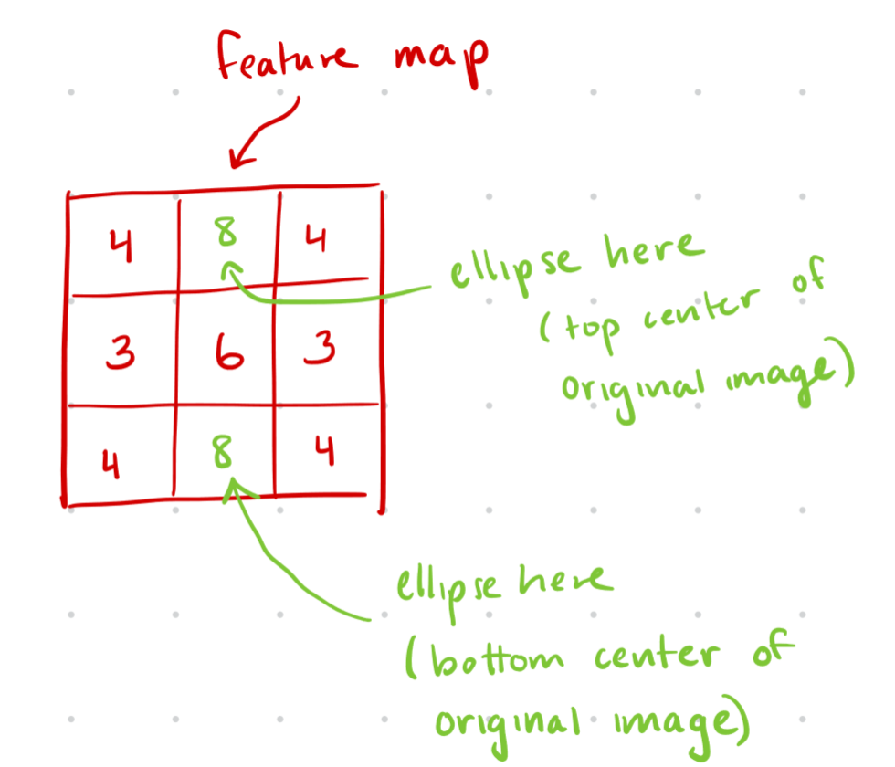
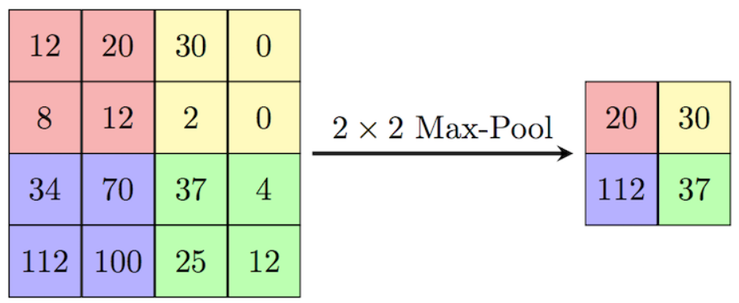
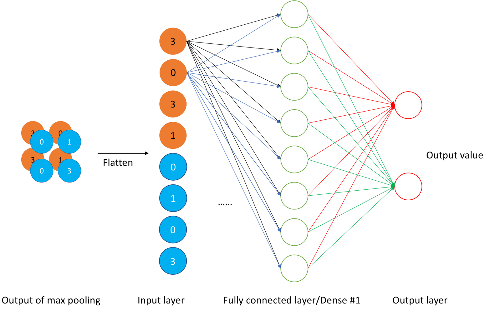

Hello and welcome to the _Computer Vision_ section of the I2 course! Here we will approach CV from a deep learning perspective, to connect better with other units.

## Technical Track Content

### Task 1

*Navigate to the relevant section of the I2 Grimoire using the link below. Read the textbook and answer all synthesis questions to the best of your ability. Be sure to save these somewhere for future reference.*

[I2 Grimoire: Computer Vision](https://grimoire.uw-i2.org/units/Computer%20Vision.pdf)

---

### Task 2

*Solve the coding challenges within the Jupyter notebook linked below (through Colab). If you encounter any issues with the notebook not functioning as described, please let us know!*

Please ask questions as you work through this project. Be sure to discuss with others in your group if you have one! Share your answers as you like, the goal is to learn and we’re not holding grades over your head.

In this project, you will be implementing a Convolutional Neural Network (CNN)! I would suggest to **read up on what [CIFAR-10](https://en.wikipedia.org/wiki/CIFAR-10) is.** before starting since this is the data you will be working with.

**Colab Link:** [Computer Vision Colab Notebook](https://colab.research.google.com/github/interactive-intelligence/intro-neuro-ai-website/blob/main/notebooks/unit-04/conv-net.ipynb) **(1 hr)**

When you are finished with your code, independently verify that it works and have fun with it! If you add any additional functionality be sure to talk about it with others and give them ideas.

Remember that this is all for your learning, so do your best and don’t stress!

Congratulations! You now understand the basics of Convolutional Neural networks!

---

## Literacy Track Content

### Task 1

*Read the article below, and answer any synthesis questions placed along the way.*

In the deep learning unit, we talked about how deep neural networks work on a very general level. Today, we’re going to talk about a new type of neural network, called a Convolutional Neural Network (CNN). These are neural networks that are specifically designed to process images. While neural networks resemble the way the human brain works, CNNs resemble the way the human vision system works. Often, a CNN is a subsection of a larger neural network: it’s like a group of layers that exists to process images really efficiently.

Let’s think back to our discussion of neural networks in unit 2. Recall that we used the MNIST dataset, which contains images of handwritten numbers (here’s a picture to remind you, with [credit](https://etzold.medium.com/mnist-dataset-of-handwritten-digits-f8cf28edafe)):

Near the end of the article, we mentioned that as we kept training our neural network, the computer would begin to pick out patterns associated with each number (like ones usually being a straight vertical line, or zeroes being a circle). But how exactly does the computer figure that out? How does the neural network “realize” what a one, a zero, or any other number looks like?

This is where the **convolutional layer** comes in. A CNN uses its convolutional layers to identify patterns and utilize them to analyze images. A convolutional layer would pick out the features that distinguish one number from the others.

Recall the structure of a general neural network.

Notice that every single node in the input layer is connected to every single node in the hidden layer. Remember, every node in the input layer corresponds to a pixel in the image. Our pictures of handwritten numbers contain 784 pixels (28 x 28), which means there are 784 nodes in the input layer. This means we have a lot of connections between the input layer and the first hidden layer, and the first hidden layer and the second hidden layer, and so on.

The reason the neural network is set up like this is because it assumes that information about every pixel influences every other pixel. But that’s not necessarily true! For example, in each image in the MNIST dataset, the dark pixels tend to be close to other dark pixels, and the light pixels tend to be close to other light pixels.

Also, the patterns associated with a given number are not exactly the same every time. Take a look at the image below ([credit](https://towardsdatascience.com/part-5-training-the-network-to-read-handwritten-digits-c2288f1a2de3)) and notice how there are slight differences in the way the numbers are written (e.g. the number 7 vs. 7 with a line through it). We need the computer to recognize that these are just variations on the exact same number.

CNNs account for both of these things, reducing the number of input nodes and allowing for variations in the pixels when identifying features in an image.

Now we’re going to get into how CNNs actually work, using a very simple image of a handwritten number.

Take a look at the image below, which shows the number 8. We’ve assigned a numerical value to each pixel, like was discussed in Unit 2.

The first thing a CNN does is use filters to identify the locations of features in the image. In our example, the most important feature of an 8 is an ellipse, because an 8 is made of two ellipses stacked on top of each other. So let’s use a filter to identify any ellipses in the image. At first, our filter just contains random numbers—but through backpropagation, it starts to resemble the shape of the feature we’re looking for (an ellipse). Below is an example of what the correct filter would look like.

Next, we put the filter over the image and compute the **dot product** of the filter and the portion of the image that it overlaps. This involves multiplying the value in the filter by the value of the pixel underneath, and adding up all the products.

Take a look at the example below. Notice that the feature in the filter (the ellipse) doesn’t perfectly match up with the pixels underneath it, so our dot product ends up being 4.

Then, we shift our filter over by one and do the same thing. The distance by which we move our filter is called the **stride**. Notice that in this next example, the feature in the filter perfectly matches with the pixels underneath, so our dot product is much larger (8).

We’ll continue shifting the filter until we’ve covered the entire image (there will probably be a lot of overlap). We keep track of all these dot products in a **feature map**. The feature map is useful because it tells us the general locations of the feature we’re tracking. Our feature map is a 3 by 3 matrix because we apply the filter nine times overall (you can try shifting the filter and calculating the dot products yourself!).

Remember, we said that when the filter perfectly matched the pixels underneath (i.e., there was an ellipse in the image), the dot product was 8. The feature map has two 8s, which tells us that there are two ellipses in the image: in the top middle of the image and in the bottom middle of the image. This fits with what we know an 8 should look like: two ellipses stacked on top of each other!

The entire process we just did, of converting an image into a feature map, is called a **convolution**.

The image we’re using, again, is really simple: it only has one distinguishing feature, which is its ellipses. If our image has multiple features (e.g. multiple lines, angles, edges, curves, etc.), we would use a different feature map for each one, and do convolutions for each feature all at the same time!

Next, we’re going to simplify this information a little bit using a strategy called **pooling**. Pooling means to reduce our feature map into an even smaller matrix that contains the most important information from each “region” of the image. Our image is a little too simple to pool any further, but below is an example of how that would work ([credit](https://paperswithcode.com/method/max-pooling)). Here, the entire top left corner is simplified to just the largest value, and so on for the other regions. This gives us a simplified understanding of the feature map overall.

The example below uses “max pooling,” which means it takes the largest value from each region to represent the region as a whole. There are other types of pooling as well, such as “average pooling,” which takes the average of the region to represent the overall region.

We repeat the convolution-pooling cycle until our feature map (or maps, if we have multiple features) is sufficiently small. Finally, we plug our resulting feature maps into a **fully connected layer**, which is like a regular old neural network. Before, all our features were analyzed independently in different convolutions. Here, we’re putting everything together and using all our collected information to classify our image. We do this by taking all of our small, pooled feature maps, flattening them into a column vector, and treating this column vector as the **input layer** to a standard neural network, which then predicts what the final image is. Take a look at the image below for an example ([credit](https://slds-lmu.github.io/seminar_nlp_ss20/convolutional-neural-networks-and-their-applications-in-nlp.html)).

This was a lot of information, so please reach out to someone if you’re having trouble with these concepts! Now lets watch the following videos and answer the associated questions.

### Video 1: [How Convolutional Neural Networks work](https://youtu.be/FmpDIaiMIeA?t=840) (12 min)

**Note:** Watch from 13:54 onward to answer the questions below. Before that is mainly review from this article (but you may find it useful to skim through, as it covers helpful math concepts!).

<iframe src="https://www.youtube-nocookie.com/embed/FmpDIaiMIeA?start=834" title="How Convolutional Neural Networks work" loading="lazy" allowfullscreen></iframe>

### Synthesis Questions

* How is backpropagation used in CNNs, and how does it differ from backpropagation in standard neural networks?
* What outcomes can a designer achieve from adjusting the hyperparameters or architecture of a CNN?
* Can you think of an example of when we can use a CNN on non-image data?

### Video 2: [But what is a convolution?](https://www.youtube.com/watch?v=KuXjwB4LzSA) (14 min)

**Note:** Watch up to 13:42 in this video; the rest is beyond the scope of this course.

<iframe src="https://www.youtube-nocookie.com/embed/KuXjwB4LzSA" title="But what is a convolution?" loading="lazy" allowfullscreen></iframe>

### Synthesis Questions

* What is the name for the smaller grid that convolves over a larger image?
    * Hint: Starts with a "k"
* What are some examples of what you can do to images if you convolve them with special matrices?
* How does Gaussian blur "work"?
* What is the name for the actual operation that occurs when the smaller grid is overlaid on the larger one?
    * When each element of the corresponding pixels are multiplied then summed.
* Give an example of a 3x3 matrix that would not do anything to the image it convolves over. Why does it not impact the image?
    * This is also known as the "do-nothing" matrix

---

### Task 2

*Complete the following writing activity.*

The non-technical project for this unit will involve some writing! **Choose 3** of the prompts below and write **at least 200** (_meaningful!_) words on each one! We will not be strictly grading you on correctness or anything like that. This is an opportunity to deeply engage with the material you have just learned about, and creatively connect it to neuroscience!

* How are CNNs inspired by the human visual system?
* What are some similarities and differences between CNNs and the human visual system?
* How is the pooling layer in CNNs related to the brain's visual processing?
* What ways does the convolutional layer in CNNs resemble the receptive field in the visual system?
* Reflecting on you have learned from this unit, what is one thing you found to be most interesting?
* What is one concept from this unit that you would like to learn more about and why?
