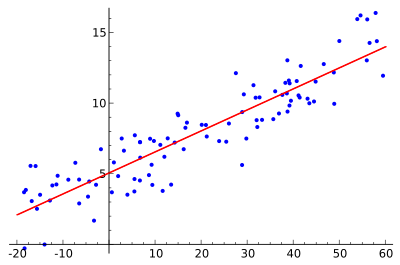
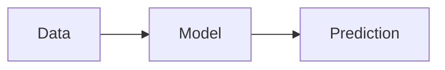

<!-- The title is already shown as the page heading, so start with an intro paragraph, not a `#` heading. Use `##` for the main sections (they are listed beside the unit) and `###` below that. -->

Welcome to the Machine Learning unit! This unit has a technical track and a literacy track.

## Technical track

### Task 1

Read the [I2 Grimoire chapter](https://grimoire.uw-i2.org/units/Machine%20Learning.pdf) and answer the synthesis questions.

<!-- Images go in images/<unit slug>/ next to this file and are added like this, with a short description of the image as the alt text:



Several images on consecutive lines (no blank line between them) are shown side by side. -->

<!-- Math uses LaTeX: `$...$` inline, and a display equation goes between `$$` lines as below (`$$...$$` on one line stays inline). Write a literal dollar sign as `\$`. -->

The sum of squared errors is $SSE = \sum_i (y_i - \hat{y}_i)^2$, and the least squares solution is

$$
\hat{w}_{LS} = (X^TX)^{-1}X^Ty
$$

<!-- Code blocks are highlighted. A `mermaid` code block is drawn as a diagram. -->

```python
import numpy as np
w = np.linalg.solve(X.T @ X, X.T @ y)
```



<!-- Embed a YouTube video with its embed link (youtube-nocookie.com/embed/<id>) and a title. -->

<iframe src="https://www.youtube-nocookie.com/embed/aircAruvnKk" title="But what is a neural network?" loading="lazy" allowfullscreen></iframe>

> **Warning:** You should never train on your test data. Use a blockquote for notes and warnings.

## Literacy track

Link other units by their path, like the [Deep Learning unit](/intro-course/deep-learning).
