Hello and welcome to the _Machine Learning_ section of the i2 course! Our content will be split into two categories: literacy and technical tracks. These topics are fundamental to the entire rest of our course, so please don't hesitate to reach out to the course staff if you have any questions!

## Technical Track Content

### Task 1

*Navigate to the relevant section of the i2 Grimoire using the link below. Read the textbook and answer all synthesis questions to the best of your ability. Be sure to save these somewhere for future reference.*

[i2 Grimoire: Machine Learning](https://grimoire.uw-i2.org/units/Machine%20Learning.pdf)

---

### Task 2

*Solve the coding challenges within the Jupyter notebook linked below (through Colab). If you encounter any issues with the notebook not functioning as described, please let us know!*

Please ask questions as you work through this project. Be sure to discuss with others in your group if you have one! Share your answers as you like, the goal is to learn and we’re not holding grades over your head.

This project will be going over **k-means clustering and PCA** (unsupervised ML). We will be using the Scikit-Learn library.

Check out this handy image that gives popular sk-learn clustering algorithms and their usages:

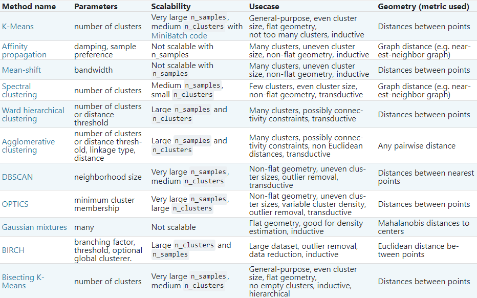

Also this image visualizing the clustering algorithms:

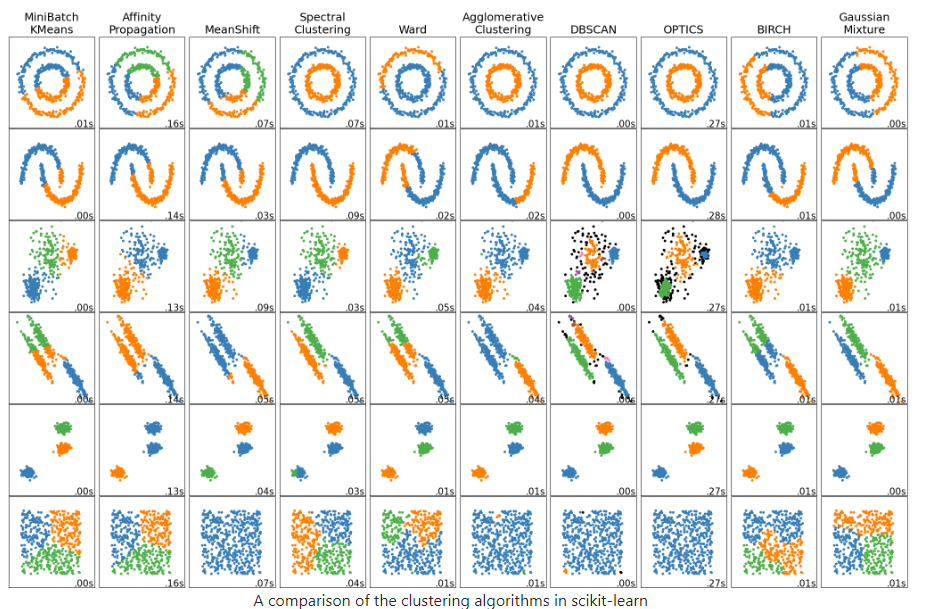

Read up on k-means clustering in the provided link (Images provided above also contained here). Feel free to check out the other algorithms as well: [SK-Learn Clustering](https://scikit-learn.org/stable/modules/clustering.html#k-means)

Now, follow the instructions on this Jupyter notebook (hosted on Google Colab) to implement some of the things we talked about! Be sure to save a local copy of the template so you can edit it.

**Colab Link:** [Machine Learning Colab Template](https://colab.research.google.com/github/interactive-intelligence/intro-neuro-ai-website/blob/main/notebooks/unit-01/lin_reg.ipynb) **(30 min)**

When you are finished with your code, independently verify that it works and have fun with it! You could try this method on different datasets, such as [this one for example](https://www.kaggle.com/datasets/ashwingupta3012/human-faces). If you add any additional functionality be sure to talk about it with others and give them ideas.

Remember that this is all for your learning, so do your best and don’t stress!

Congratulations! You now understand the basics of Clustering and PCA!

---

## Literacy Track Content

### Task 1

*Read the article below, and answer any synthesis questions placed along the way.*

This article is going to cover what machine learning is at a conceptual level.

Machine Learning (ML) is a powerful subset of artificial intelligence (AI). AI is the broad concept of creating machines that can mimic human intelligence, while machine learning specifically focuses on algorithms that learn from data to make predictions or decisions, improving with experience.

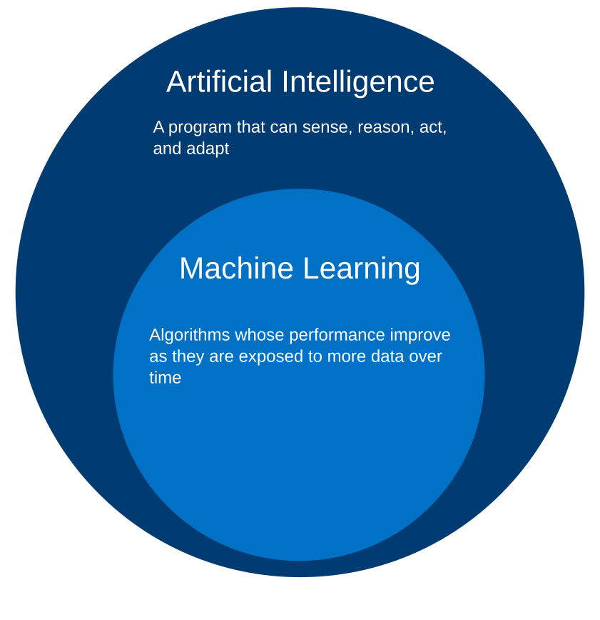

The general idea behind machine learning is that a machine uses known information to make predictions about unknown information—much like humans. For a long time, we used computer programming to manually give computers instructions on how to do things. But there are a lot of things that we may want computers to do that are far too advanced to manually instruct them on.  The goal of machine learning, then, is to get computers to “learn” how to do tasks so that we don’t have to give it explicit instructions.

To better understand this, let’s look at an example.

Imagine we want our computer to identify pictures of cats and pictures of pigs.

Our computer has never seen a pig or a cat before, so we have to give it some information to help it get started. Let’s feed our computer the following images. We’ll label the pictures of cats “cat” and the pictures of pigs “pig,” so the computer knows which is which.

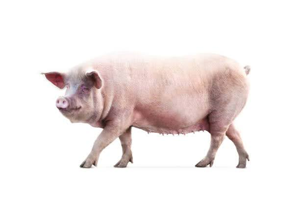
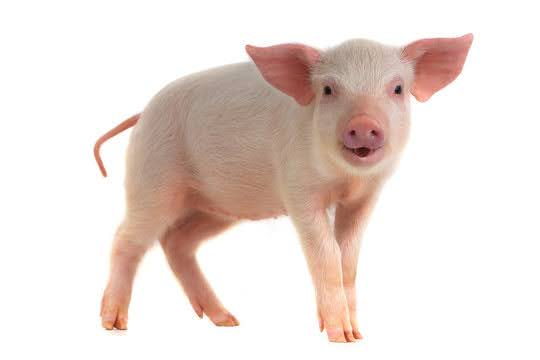
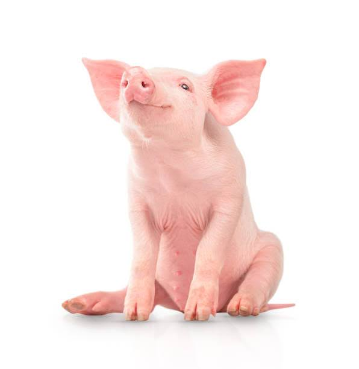

Now the computer has to figure out what makes the cat pictures different from the pig pictures. What does it notice? Well, all the cats are furry and all the pigs are pink. So the computer comes up with the following system:

- if the picture has a furry, non-pink animal, it’s a cat
- if the picture has a non-furry, pink animal, it’s a pig
- otherwise the computer isn’t sure

Okay, let’s see how it does! We give the computer these three pictures and ask it to classify them as “cat” or “pig.”

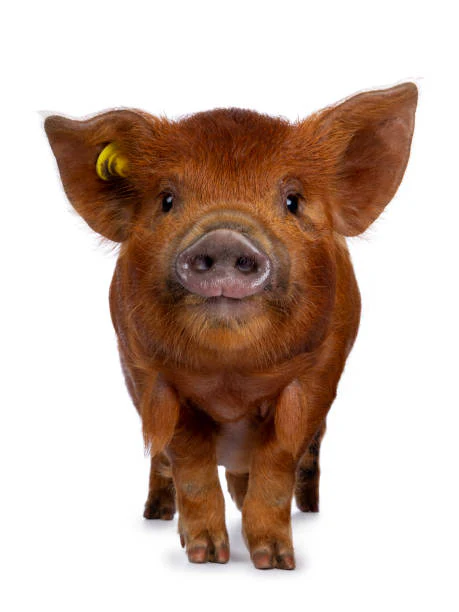

The computer classifies the first animal, which is furry and not pink, as a cat—perfect! But it classifies the second, which is not furry and pink, as a pig, and the third, which is furry and not pink, as a cat.

Now we have to correct our computer. We let it know that it was right about the first image, but the other two were wrong.

Here’s where the crucial part of machine learning comes in: the computer looks at the images again and learns why it was wrong. It realizes that not all cats are furry and not all pigs are pink. Maybe it also realizes that all the cats we provided have long tails, and all the pigs have long snouts.

Whatever the case, the computer learns how to better classify the animals based on the data we provided. It learns which features are crucial and which features are optional in its decision, and the more data we provide, the more it refines its processes and produces accurate predictions. This occurs over many, many, many trials, until it finally begins to make perfect predictions. This is the very general idea of how machine learning works.

But what does it mean for a computer to “learn”? How does a machine “learn” anything, the way humans learn? For that matter, how can the computer tell that the pictures of cats have fur in them, or that the pictures of pigs contain long snouts?

These are exactly the questions that this course aims to answer. We’ll learn how humans learn, how machines learn, and how our understanding of one allows us to develop our understanding of the other. We’ll also learn how humans interpret images and pictures, and how we can use that information to get computers to do the same thing.

#### Synthesis Questions

* What are the limitations of early “if this, then that” logic?
* Why do we need a teach-build cycle to get our machine to learn?
* Why does this teach-build-teach-build cycle work? How do the "bots" get better over time?
* Why is it so important for companies to use a good dataset to teach their bots?

#### Data Splitting: Train and Test Sets

Consider the following scenario. We train a model to recognize whether an image is of a dog or cat. However,
the model is a huge model and picks up on every little detail, every single noise pixel of every image. It is *really* good,
but what happens if you try to deploy this model? It fails! This is because it *overfit* to the training data and could not generalize well.
In order to make sure this is not happening, we can use train and test splits to validate and compare different models before we deploy them.

Train/Test Split refers to this method of dividing the dataset, typically using an
80-20 or 70-30 ratio. For example, in an 80-20 split, 80% of the data is used for
training, and the remaining 20% is held back for testing.

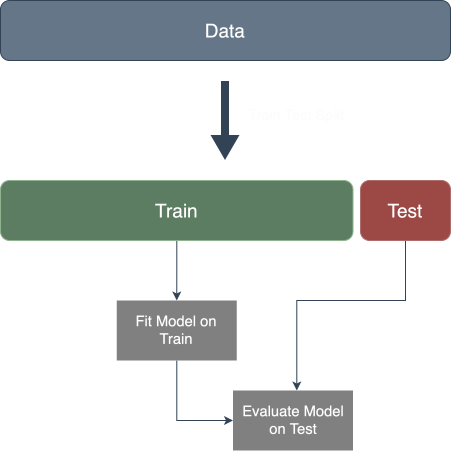

> **Warning:** You should ***NEVER*** train on your test data, which includes tuning your model on it.

In practice, the following steps are often taken when working with train/test splits:

- Step 1: Data Splitting. Split the data into training and test sets before
  training the model. This prevents any information from the test set from
  leaking into the model.
- Step 2: Model Training. Use the training set to build the machine learning
  model by adjusting weights, minimizing errors, or finding patterns.
- Step 3: Model Evaluation. Once the model is trained, evaluate it on the
  test set. Common evaluation metrics include accuracy, precision, recall, and
  mean squared error, depending on the type of model.

In some cases, a third subset called a validation set is also used. The validation
set helps tune hyperparameters and prevent overfitting before final testing on the
test set.

#### Regression vs Classification

Machine learning generally tackles two major types of problems: regression and
classification.

**Classification** is the task of categorizing a set of items into predefined classes. For
example, classifying an image as either a “cat” or a “dog.” The output is typically a
discrete label, such as “yes” or “no,” or in this case, “cat” or “pig.”

On the other hand, **regression** is about predicting a value, which cannot be broken up into separate classes. For
instance, predicting a person’s weight based on their height is a regression task,
where height is the input feature and weight is the predicted continuous value. In
multiple regression, multiple features (like height, age, etc.) are used to predict an output,
such as house prices or stock market trends.

In the next two sections, we will look at one example of regression, followed by one example of classification.

#### Linear Regression (Regression)

In machine learning, linear regression is one of the most fundamental algorithms. It tries to model the relationship
between input features and the ouput by simply fitting a straight line, something like this:

A key concept is that the line tries to minimize the distance to all of the points.

#### Logistic Regression (Classification)

Instead of a straight line, logistic regression takes the form of an $S$-shaped curve, with the outputs bounded between 0 and 1.

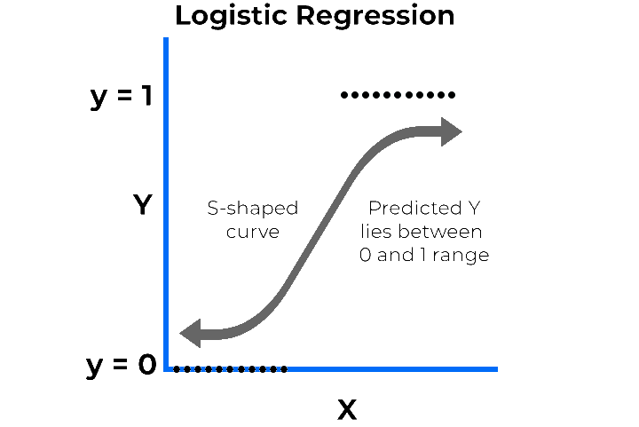

Since this is a classification task, the output is always either 0 or 1, and nothing in between. However the outputs can be any number
between 0 and 1, which we can use as a "confidence" score. If the model outputs a number close to 1, it is quite confident that the class
is 1, while if the model outputs a number that is closer to 0.5, it is less confident. Since the model actually predicts a value instead of a class,
there is "regression" in the name.

There are ways to logistic regression beyond two classes, such as One vs Rest, where we train $k$ separate classifiers for $k$ classes, and take the
largest value, but that is beyond the scope of this course.

#### More Classification: Decision Trees

Let's move on to a more intuitive type of classification algorithm. Suppose you want to classify animals. One of the most intuitive ways is to group animals by
features and break them up into small logical decisions. You might end up with a tree like this:

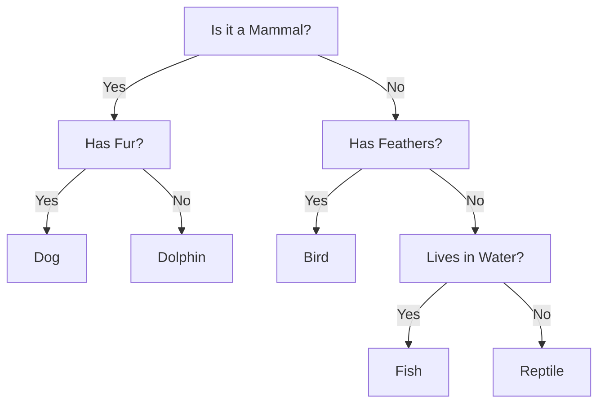

This is exactly what a decision tree is! The algorithm tries to find the best ways to split data each step so that using only
a series of binary questions ("Does the animal have wings?", or "Is the height greater than 10 cm"), we can narrow down to the true class.

There are also ensemble classifiers such as Random Forests, which consists of many different decision trees that "vote" on the answer, leading to greater accuracy
and better generalization.

#### Synthesis Questions

* What is the difference between regression and classification?
* What kind of function does linear regression use?
* What kind of function does logistic regression use?
* How does a decision tree work?
* Why does logistic regression have "regression" in the name?

#### K-Means: Unsupervised Learning

In the previous sections, we talked about **supervised learning**, where we had to teach the model with explicit labels for our data. In this section,
we will explore **unsupervised learning**, where the labels are not provided, and the model aims to find hidden patterns and structure inside of our data.
One powerful example of unsupervised learning is **k-means clustering**. This algorithm attempts to group the data into $k$ clusters, where each cluster
constains points that are similar to each other. There is no "right answer". Rather, we would like the algorithm to uncover these clusters on its own.

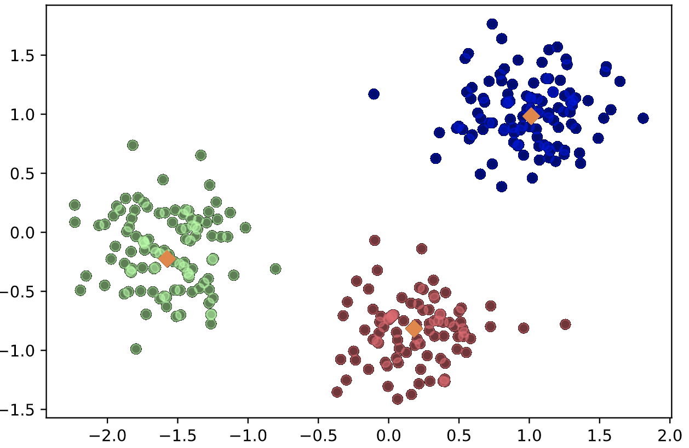

---

### Task 2

*Complete the following writing activity.*

The non-technical project for this unit will involve some writing! **Choose 3** of the prompts below and write **at least 200** (_meaningful!_) words on each one! We will not be strictly grading you on correctness or anything like that. This is an opportunity to deeply engage with the material you have just learned about, and creatively connect it to neuroscience!

* Recall that Machine Learning focuses on algorithms that learn from data in order to make predictions or decisions. What kinds of applications are you most interested in, and what would be the input and the output of the model? Would this be a classification or regression problem?
* Do you believe a model, just by producing outputs given inputs, can understand the world the way humans can? For example, ChatGPT is a machine learning model because it tries to predict an appropriate response given an input sequence based on their probability, but does it actually understand what it is talking about? Argue why or why not.
* Machine learning models learn from the data they are given rather than explicit programming. There is a concept in AI known as "Garbage in, Garbage out", referring to the fact that if you feed a machine learning model poor and unreliable data, the model itself will also be poor and unreliable. Think about an application you might train a model for. Then, think about the ways the data might be unreliable, and what steps might you take to mitigate this?
* What are some ethical implications of applying machine learning models to the real world? For example, think about what might happen if a person does not fit societal norms and gets misclassified.
* Write about anything interesting that remotely relates to this unit!
