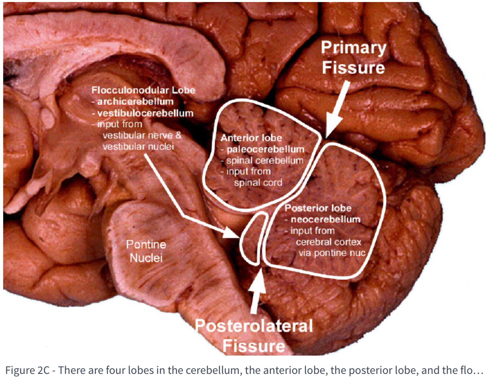

We are now going to be learning about how your brain makes you act and move in your environment. We start by investigating the cerebellum. This will tie into Reinforcement Learning (RL), so pay attention!

First, a few useful vocab words:

> Afferent: Conducting towards something

> Efferent: Conducting away from something

## Task 1

Read the sections entitled “Feed forward control systems” and “The cerebellum may be a feedforward control system” from the notes here to get a sense for the purpose of the cerebellum.

[Cerebellum – The University of Texas Medical School](https://nba.uth.tmc.edu/neuroscience/m/s3/chapter05.html)

Then, watch the following brief videos, take notes if you’d like!

[2-Minute Neuroscience: Cerebellum](https://www.youtube.com/watch?v=Fir-v6EoZNE)

<iframe src="https://www.youtube-nocookie.com/embed/Fir-v6EoZNE" title="2-Minute Neuroscience: Cerebellum" loading="lazy" allowfullscreen></iframe>

[19.3 Cerebellar Information Flow](https://www.youtube.com/watch?v=phi_13iP4mM)

<iframe src="https://www.youtube-nocookie.com/embed/phi_13iP4mM" title="Cerebellar Information Flow" loading="lazy" allowfullscreen></iframe>

### Synthesis questions

* Explain the difference between mossy fibers and climbing fibers and their respective functions.
* Which cells or fibers may be responsible for sending error signals to the cerebellum?
* What is the function of a Purkinje cell? To what do they output? What do they look like? Why might they look like this?
* What are the primary input sources of the cerebellum? Where do these signals originate?

For more depth on these topics, here are some more fabulous resources.

## Bonus videos

[19.4 Cerebellar Circuits](https://www.youtube.com/watch?v=V0hLdqaH-7w)

<iframe src="https://www.youtube-nocookie.com/embed/V0hLdqaH-7w" title="Cerebellar Circuits" loading="lazy" allowfullscreen></iframe>

[19.5 Afferent Tracts to the Cerebellum](https://www.youtube.com/watch?v=jYD91uxWUys)

<iframe src="https://www.youtube-nocookie.com/embed/jYD91uxWUys" title="Afferent Tracts to the Cerebellum" loading="lazy" allowfullscreen></iframe>

## Project spec

There is no project for this unit yet. We hope to make one soon!
