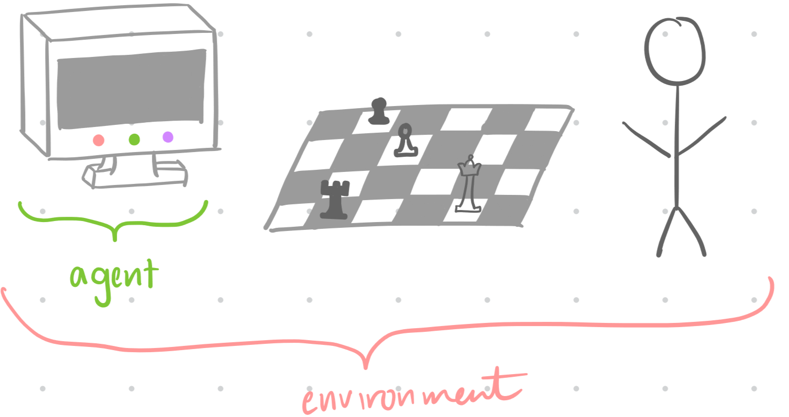
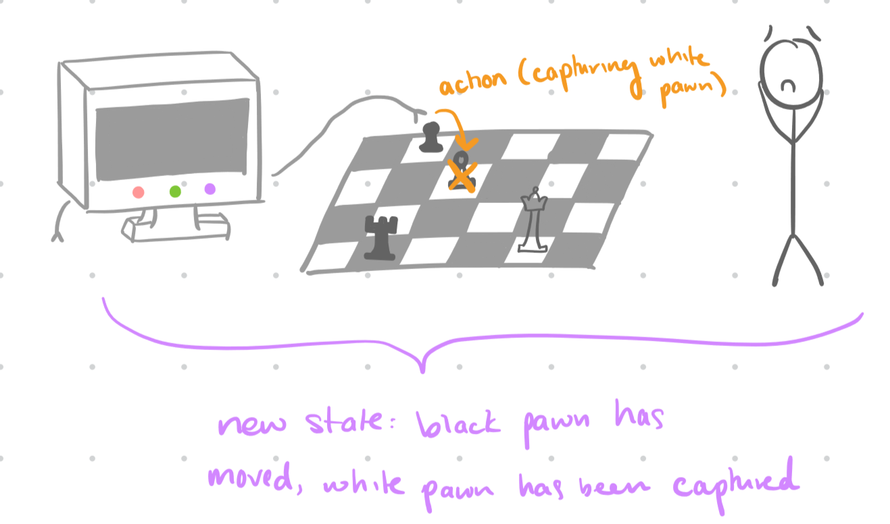
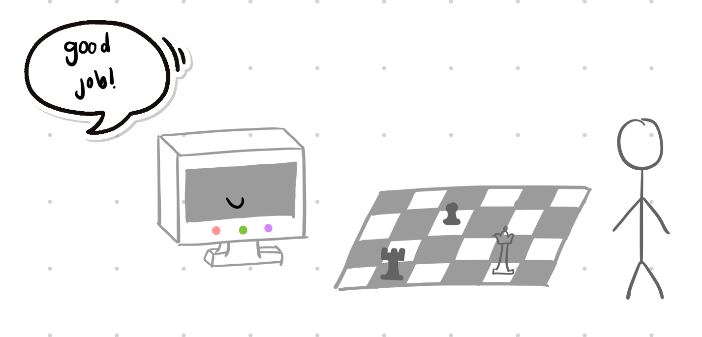
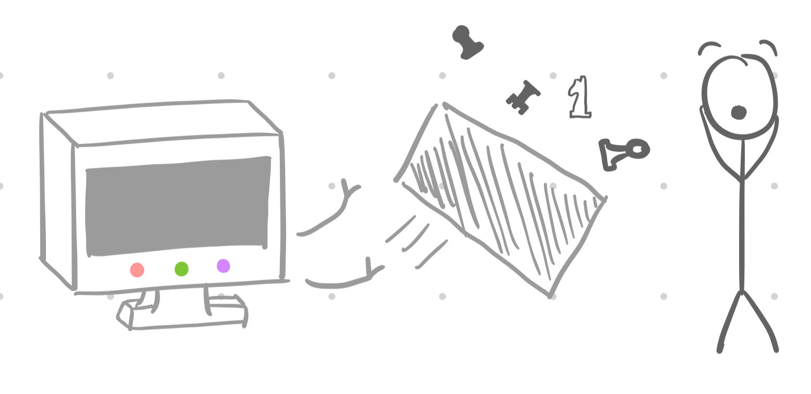
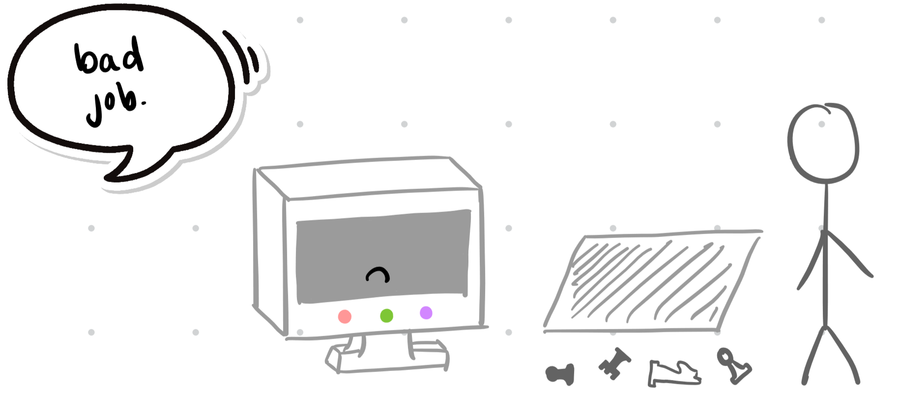
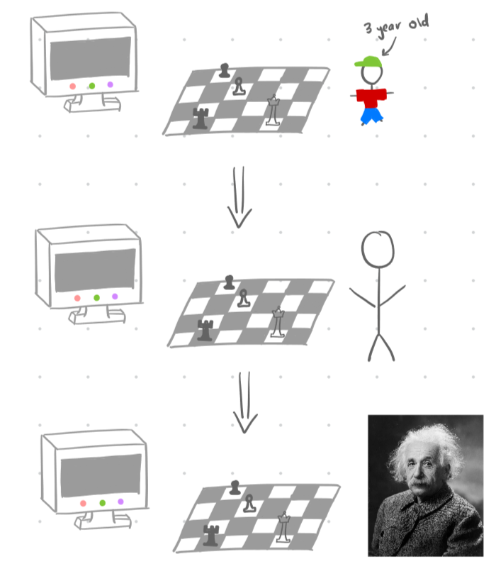

Welcome to the Reinforcement Learning section of the I2 Course! The topics in this unit should get you really
thinking about NeuroAI. Be sure to ask lots of questions!

## Technical Track Content

### Task 1

*Navigate to the relevant section of the I2 Grimoire using the link below. Read the textbook and answer all synthesis questions to the best of your ability. Be sure to save these somewhere for future reference.*

[I2 Grimoire: Reinforcement Learning](https://grimoire.uw-i2.org/units/Reinforcement%20Learning.pdf)

---

### Task 2

*Solve the coding challenges within the Jupyter notebook linked below (through Colab). If you encounter any issues with the notebook not functioning as described, please let us know!*

Please ask questions as you work through this project. Be sure to discuss with others in your group if you have one! Share your answers as you like, the goal is to learn and we’re not holding grades over your head.

In this project, you will be implementing parts of a simple Q-Learning algorithm for a "cartpole" environment.

**Colab Link:** [Reinforcement Learning Colab Notebook](https://colab.research.google.com/github/interactive-intelligence/intro-neuro-ai-website/blob/main/notebooks/unit-06/rl_net.ipynb) **(1.5 hr)**

When you are finished with your code, independently verify that it works and have fun with it! If you add any additional functionality be sure to talk about it with others and give them ideas.

Remember that this is all for your learning, so do your best and don’t stress!

Congratulations! You now understand the (_incredibly basic)_ basics of Deep RL!

---

## Literacy Track Content

### Task 1

*Read the article below, and answer any synthesis questions placed along the way.*

Welcome to one of the most important units in this course—and one of the most challenging! Like all our articles, the goal of this article is to give you an intuitive understanding of reinforcement learning so that you can recognize it in daily life and apply it to technical projects.

Reinforcement learning is the study of how a free object, or **agent**, moves around and accomplishes tasks in an **environment**, either real or simulated. The very general idea involves rewarding the object for desirable actions (i.e. reinforcing that behavior) and punishing it for undesirable actions.

For example, suppose we’re teaching a computer how to play chess against a human. In this case, the agent would be the computer and the environment would be the chess game (i.e. the opponent, board, and pieces).

The computer starts by taking an **action**--in other words, it does something. In this case, say the computer captures one of the human opponent’s pawns. Now the environment (the chess game) looks different from before the computer took its action; the computer has changed the **state** of the environment.

The state of the environment is favorable—we’re glad the computer took this action, and we want to reinforce it (we want it to keep taking actions like this). So we give the computer a **reward** that’s proportional to how desirable the action was. In this case, the reward is pretty moderate—capturing a pawn is good, but it’s not one of the best moves the computer can make. If the computer had captured the opponent’s queen, for example, we’d give it more of a reward because that’s a more desirable action.

Suppose the computer takes a different action: instead of capturing a pawn, it knocks over the entire board. Again, our environment is in a new state as a result of this action.

Unfortunately, this new state is very bad for the computer because there’s no way it can win the game now. So we want to punish this action and make sure the computer avoids it in the future. We can do this by giving it a negative reward to indicate that it’s an undesirable action.

The computer decides what steps to take using something called a **policy**. A computer uses a policy to decide what its next step should be. For example, maybe the computer’s policy is to maximize its rewards. Then, every single action it takes is the action that produces the highest reward. This helps it avoid undesirable actions, like knocking over the board, because they have such low rewards.

This isn’t always the best policy, though. We said earlier that capturing the opponent’s queen is a very high-reward action. Suppose the computer is in a position where it can capture its opponent’s queen, but in doing so leaves its king vulnerable. In this case, maybe taking the highest-reward action isn’t the best way to go. We would have to use a different policy in our decision-making.

Deep reinforcement learning combines deep learning and reinforcement learning. Its goal is to get the computer to learn to do something, and it teaches the computer using the principles of RL.

Take a look at the short video below, which tries to teach a robot to walk using deep reinforcement learning (don't worry, you'll have fewer Synthesis Questions to make up for the extra video!).

### Video 1: [AI Learns to Walk (deep reinforcement learning)](https://youtu.be/L_4BPjLBF4E?si=jtH5sPdoihN60MLh) (9 min)

<iframe src="https://www.youtube-nocookie.com/embed/L_4BPjLBF4E" title="AI Learns to Walk (deep reinforcement learning)" loading="lazy" allowfullscreen></iframe>

Notice that the robot wasn’t given any directions. It was given a target, and every action it took was rewarded or punished, but it ultimately had to learn the correct sequence of actions that would allow it to walk.

If we apply this to our chess example, the target might be to win the game by capturing the opponent’s king. We won’t tell the computer how to do that, but every time it takes an action we can reward or punish it. That way, it starts to learn the correct sequence of actions that it needs to take in order to win the game.

Also, like in the video, we can put our chess computer in different environments to force it to learn new actions. For example, we can start it out in an environment where its opponent is a three-year-old. As the computer gets better, we can put it in new environments with more and more advanced opponents to force it to learn new skills, in the same way the robot in the video became better at walking by crossing more and more difficult terrain.

Now let's watch some videos on RL.

### Video 1: [Reinforcement Learning: Crash Course AI #9](https://youtu.be/nIgIv4IfJ6s?si=_ppJ4srBtfy04L7x) (12 min)

<iframe src="https://www.youtube-nocookie.com/embed/nIgIv4IfJ6s" title="Reinforcement Learning: Crash Course AI #9" loading="lazy" allowfullscreen></iframe>

### Synthesis Questions

* When does it make sense to use reinforcement learning vs. other methods of machine learning to accomplish a task?
* How do the agent, action, and environment interact in reinforcement learning?
* Give an example of two different policies in a reinforcement learning environment that’s NOT the cookie-jar example from the video (but you can use the chess game, the walking robot, or something you come up with yourself!).

### Video 2: [Reinforcement Learning from scratch](https://www.youtube.com/watch?v=vXtfdGphr3c) (8 min)

<iframe src="https://www.youtube-nocookie.com/embed/vXtfdGphr3c" title="Reinforcement Learning from scratch" loading="lazy" allowfullscreen></iframe>

### Synthesis Questions

* What is the purpose of a sigmoid function, and what does its value tell us? What about an error function?
* Describe the idea of gradient descent and how we use it in reinforcement learning.

---

### Task 2

*Complete the following writing activity.*

The non-technical project for this unit will involve some writing! **Choose 3** of the prompts below and write **at least 200** (_meaningful!_) words on each one! We will not be strictly grading you on correctness or anything like that. This is an opportunity to deeply engage with the material you have just learned about, and creatively connect it to neuroscience!

* Can you provide examples of experimental evidence linking reinforcement learning algorithms to observed synaptic changes in the brain?
* How do human neural systems encode reward signals and how does this relate to the concept of rewards in reinforcement learning models?
* What ethical considerations should be taken into account when developing interventions based on neuroscientific findings, and how can accountability be established for the potential impacts of such interventions?
* Reflecting on you have learned from this unit, what is one thing you found to be most interesting?
* What is one concept from this unit that you would like to learn more about and why?
